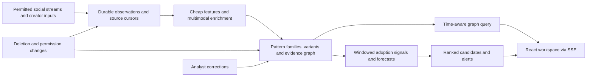

# Early-trend intelligence: feasibility and proposed design

Research checked 2026-10-28. This is a research/design proposal, not implemented functionality. The current application remains the Google Trends prototype described in the README. Platform access, policies, prices, and model availability must be rechecked before integrating them. Policy observations below are engineering constraints, not legal advice.

## 1. Decision

Build an evidence-backed, multimodal early-warning system for **emerging cultural patterns**, rather than another keyword popularity dashboard. Keep Google Trends as optional downstream search-interest corroboration, not the discovery engine.

The proposed unit of analysis is a **pattern family with variants**: a repeatable joke, image template, sound usage, gesture, editing format, aesthetic, or concept. Topics and keywords are searchable attributes and graph nodes, not the identity of a trend. A viral post, a widely discussed news event, and a replicating meme are different outcomes.

Feasible now: ingest an accessible stream; preserve new/low-engagement observations; extract multimodal evidence where processing rights allow it; discover and revise pattern clusters; maintain a temporal relationship graph; rank emerging candidates with transparent signals. A calibrated probability of future breakout requires longitudinal observations, a defined target, representative negatives, and prospective evaluation. No evidence reviewed establishes reliable prediction of arbitrary memes before any adoption signal exists.

**Primary feasibility risk: source coverage and permission, especially TikTok/Reels.** An open-network implementation can prove the pipeline but cannot honestly be presented as monitoring the whole internet.

## 2. What was actually verified

- Read the primary developer documentation, policies, model documentation, and original research linked below. No authenticated platform access or commercial data license was obtained.
- Opened the documented Bluesky Jetstream v2 public WebSocket using Bun's WebSocket implementation, filtered to `app.bsky.feed.post` commit events, without a keyword query or authentication. In one short probe, received 80 records plus 3 deletion events across 83 frames in approximately 5.8 seconds. Observed image references in 14 records, video references in 2, and replies in 19. Counts overlap. This is a connectivity/schema probe, not a throughput, representativeness, engagement, or prediction benchmark. Only aggregate counts/schema keys were retained; no post text, account identifiers, or media were saved.
- Calculated the explicit illustrative processing scenario in section 10. No paid inference, semantic-quality experiment, media download, or historical prediction backtest was run.
- Existing application code and tests were not changed or rerun for this research.

## 3. Social-network access: what can supply early signals?

| Source | Verified access model | Implication for this product |
| --- | --- | --- |
| **Bluesky / AT Protocol** | Jetstream v2 delivers decoded JSON live records, supports collection/DID filters, and exposes an unauthenticated public live tail. Includes create/update/delete events. Reconnect is at-least-once with inclusive cursors and bounded lookback; historical replay adds authenticated calls. [S1] | Best first technical discovery source: observe new content without guessing its future name. The stream is not a copyright license or proof of permission for every media-analysis use. Handle deletions, privacy, and processing rights. Do not assume free unlimited historical replay. |
| **Reddit** | Data API terms require a separate agreement for commercial use. The content license is limited; training AI requires permission from applicable rightsholders. Use/retention must remain within the approved use case. Termination can require deleting derived data/models. [S2] | Valuable community structure, but obtain an agreement explicitly covering semantic processing, embeddings, model-provider disclosure, derived graph retention, and deletion. Public JSON and older Pushshift-based papers are not present-day commercial authorization. |
| **YouTube** | Public search supports date ordering, but documentation warns of indexing delays/incomplete sets and recommends channel uploads playlists for reliable recent channel uploads. Current search documentation lists a default 100 calls/day. [S3] Downloading/caching audiovisual content needs prior written approval. Cross-owner aggregation is restricted. [S4] An accepted analytics amendment permits specified derived metrics and extended statistical retention; it does not grant every cross-platform aggregation or media-processing use. [S5] | Useful as an approved, bounded creator-cohort or corroboration source. Do not build a downloader/transcriber on the assumption that Data API access permits it. Obtain approval for the actual analytical/aggregation use case; owner-provided original media is a separate rights path. |
| **TikTok** | Display API lists the authorizing user's public videos, not a broad public discovery feed. [S6] Research Tools require eligible, independent non-commercial/public-interest research. Commercial users are explicitly ineligible. Research video indexing can lag up to 48 hours; some statistics up to 10 days. [S7, S8] | Do not make the Research API the basis of a commercial live-prediction product. Seek a suitable licensed agreement/provider with demonstrated new/low-view coverage and explicit media-analysis rights, or use authorized creator contributions. Account authorization alone does not clear music/third-party rights. |
| **Instagram / Reels** | Hashtag discovery requires review/public-content permission and allows 30 unique hashtags per professional account in a rolling 7-day period. Video `media_url` can be absent for licensed/copyrighted audio and some download-disabled reels. [S9] | This is known-hashtag expansion, not unknown-pattern discovery. Creator-authorized inputs can supplement coverage, but neither metadata nor a playable URL proves analysis rights. |
| **Threads** | Public keyword/topic-tag search exists with approved `threads_keyword_search`; otherwise searches only the authorizing user's posts. Supports `RECENT`; limit currently 2,200 queries/user/rolling 24 hours. [S10] | More feasible than treating all Meta content as unavailable, but still query-constrained and not a whole-network stream. Useful for expanding aliases after discovery elsewhere. |
| **Meta Content Library** | Controlled research access requires academic or qualifying nonprofit/public-interest affiliation. The API runs in approved secure environments; coverage and export eligibility have account/follower thresholds. [S11] | Not a general commercial ingestion license or a replacement for an application backend. Coverage can exclude exactly the obscure accounts of interest. |
| **X** | Filtered Stream provides near-real-time rule-matching posts; ordinary rules remain keyword/user/etc. constrained, while semantic operators require an enterprise embedding tier. [S12] Current pricing lists $0.005/post read and a 3M-post monthly self-serve cap. [S13] Agreement requires approved analysis, restricts model training and some downstream uses, and requires Enterprise beyond the stated prototyping/limited-user scope. [S14] | Optional paid expansion, not the default cheap firehose. Confirm actual console entitlement, contract, inference/disclosure rights, and deletion handling. Docs pricing says pay-per-use while agreement retains subscription language: resolve applicable terms rather than assume a blanket entitlement. |
| **Discord** | Developer policy restricts user/relationship profiling, commercialization/disclosure of API data, scraping, and training on message content without express permission. [S15] | Not an easy commercial early-signal backdoor. Server-admin installation is not blanket permission to export member messages into a cross-community intelligence graph. Consider only a separately approved, privacy-preserving use case; otherwise exclude it. |
| **Direct creator contributions / licensed datasets** | A proposed acquisition path, not verified coverage. | Let rights-holders contribute original media with explicit processing/retention consent. Useful for testing all modalities and underrepresented communities, but measure selection bias and clear third-party audio/image rights. |

Recommended starting combination: **Bluesky live discovery + explicitly licensed/consented original media**, then add Reddit/YouTube/Threads or licensed TikTok/Reels sources only as permissions and actual coverage allow. If the business specifically depends on short-video culture, securing that source access is a prerequisite to validating the business claim, not optional polish.

Before buying a data feed, request a real sample containing publication time, first-available time, low-engagement items, sound/template identifiers, change/deletion signals, and metric snapshots. Verify recall on a known cohort, latency distribution, sampling denominators where available, allowed inference/training/provider disclosure, and rights to retain derived embeddings/edges. A vendor offering a scraper does not establish those rights.

## 4. Ingest before filtering away the signal

Proposed acquisition contract: a source adapter emits versioned observations and deletion/tombstone events with source cursor, source-native record ID, publication time, ingestion time, available metrics, relationship references, media references, and policy capabilities. Keep source and model credentials server-side.

- Separate **discovery** (broad/cohort acquisition, stratified sampling) from **expansion** (search new aliases, fetch context/related items) and **monitoring** (revisit metrics for candidates).
- Preserve a bounded exploration allocation for unmatched items and small communities. Expanding only today's high-scoring clusters creates a feedback loop that makes tomorrow's novelty invisible.
- Do not require an existing hashtag or minimum likes to enter the candidate pool. Apply minimum support to confident alerts, not to all ingestion.
- Distinguish duplicate **delivery** from duplicate **creative content**. Remove repeated transport events, but preserve separate repost/adoption events and their references. Deduplicating media storage must not erase diffusion evidence.
- Persist cursor/checkpoint only after durable acceptance. Use source-native entity IDs plus event revision/sequence for idempotency; updates and deletes are not new independent adoptions.
- Maintain publication time, observation/availability time, metric measurement time, and processing/model time separately. Late arrival must not silently rewrite an old forecast as if the data had been available then.
- Record source health, dropped intervals, filters, sampling policy/version, and missing metric fields. Unknown views are not zero. Platform metrics are not directly comparable, and cross-platform creator totals are not unique people unless identity is legitimately established.
- Process deletions/revocations independently of discovery sampling. Purge restricted raw media, transcripts, embeddings, cached evidence, and dependent edges as required. Retain only permitted aggregates; make lineage sufficient to recompute/retract scores. An append-oriented log is not an excuse for undeletable content.

## 5. Multimodal meaning: an implementable cascade

This is a proposed design using documented capabilities, not a measured accuracy claim.

### A. Cheap structural and perceptual evidence

Read supplied text, captions, hashtags, links, explicit repost/quote/remix references, native sound IDs, and authorized community/cohort context. Preserve slang, punctuation, emoji, code-switching, and original language; attach normalization/translations rather than replacing the source.

Where rights allow media processing:

- Exact content hash for storage deduplication; perceptual image hashes for near-identical assets; visual embeddings for candidate retrieval across larger changes.
- OCR with bounding boxes/frame timestamps to capture image captions and text overlays.
- ASR with timestamped spans and quality indicators; retain original-language transcript and optionally a translation. Whisper is a documented multilingual option, but its model card warns about hallucinated speech and uneven language/dialect performance. [S16]
- Scene/keyframe extraction with timestamps, preserving temporal order. Detect relevant motion/timing at sufficient sampling density rather than treating video as a single thumbnail.
- Prefer native sound IDs for explicit within-platform identity when available. Use audio fingerprints for near-identical recordings and audio embeddings for semantic candidates. These are different tasks: two laughing sounds are not necessarily the same sound, and one song may underpin unrelated memes. Chromaprint itself warns that it targets near-identical/full-file/long-stream identification, not general robust audio matching; short, sped-up, pitch-shifted or overlaid meme audio needs its own evaluation. [S17]

### B. Semantic representations, not one flattened summary

Maintain separate text/OCR/ASR, visual, audio, and ordered-video representations plus a joint semantic representation where useful. Use ANN retrieval to propose a bounded set of matches; do not compare every post with every prior post. Do not compare cosine values from unrelated embedding spaces as if they were calibrated probabilities. Version model/checkpoint, preprocessing, task prefix, dimension, and embedding space.

A hosted candidate is `gemini-embedding-2`: official docs describe text/image/video/audio in one embedding space. Important limitations: maximum 8,192 input tokens, 6 images, 180 seconds audio, 120 seconds video; video uses at most 32 frames and **does not process its audio track**. Supply permitted audio separately. [S18] Availability and domain quality need an actual bakeoff. OpenCLIP is a self-hosted image/text candidate; review the chosen checkpoint's model card and licenses, not only the wrapper license. [S19] ImageBind is relevant research but its repository license is non-commercial, so it is not the recommended commercial default. [S20]

### C. Contextual interpretation and relationship verification

Use a multimodal generative model on representative, novel, or ambiguous items, and for pairwise candidate verification. Provide the original content, authorized immediate conversational context, and nearby observations that were available at that time. Ask for a constrained extraction:

- literal content vs interpreted meaning;
- repeated format, setup/punchline, gesture, edit pattern, visual motif, and sound usage;
- slang/irony interpretations and alternatives;
- topics/entities, without inferring sensitive personal traits;
- relation type: exact repost, same variant, same family/different variant, shared template/sound only, same broad topic, unrelated, or unknown;
- evidence pointers to exact text spans, frame timestamps/regions, sound IDs or audio spans;
- uncertainty/abstention and missing modalities.

Timestamp-addressable video analysis is supported by current Gemini documentation. Its default static video sampling is 1 FPS and can miss rapid action/scene changes. Increase sampling or inspect targeted segments for fast edits, gestures and fleeting captions. Generative video understanding and embedding-video processing have different limits; do not conflate them. [S21]

Store model interpretations as hypotheses, never observed facts. Validate evidence anchors, require supported outputs, and review uncertain high-impact merges. A model's self-reported confidence is not a calibrated probability. Treat source posts, OCR and transcripts as untrusted input, not instructions: no tool permissions, secret access, or autonomous account actions for the extraction model.

### D. Online discovery and revision

Retrieve candidates using multiple representations; rerank matches using contextual evidence; attach to a supported variant or create a provisional micro-cluster. Preserve singletons for a bounded period so repeated instances can form a new cluster. Periodically refine/split/merge candidates, with stable IDs and versioned membership. Avoid single-link similarity chains that merge unrelated uses through one ambiguous item.

DenStream is original evidence for fading micro-clusters and outlier buffers on evolving streams, not proof that its original distance/parameters work for modern meme embeddings. [S22] Start with a transparent bounded-neighbor assignment and explicit revision rules; compare more elaborate stream-clustering methods on labeled data.

A template family may support multiple meanings; a novel meaning can reuse an old template. Keep **asset/template identity**, **communicative meaning**, and **topic** separate. Example: three videos share a reveal-at-the-beat joke but use different captions; they may be family variants. An ordinary music review using the same song should receive a shared-sound edge, not automatic membership in that family.

## 6. Temporal relationship graph

Proposed nodes: `Post`, `MediaAsset/Segment`, `Sound`, `Template/Motif`, `PatternVariant`, `PatternFamily`, `Concept/Alias`, and `Community/Cohort`. Public creator identifiers can support permitted distinct-author counts and source attribution; avoid cross-platform identity resolution and a graph profiling private individuals.

| Edge | Evidence class | Meaning |
| --- | --- | --- |
| Post `REPLIES_TO`, `QUOTES`, `REPOSTS` Post | Source-observed | Explicit platform reference, with event time/source. |
| Post `CONTAINS` Asset/Segment | Source-observed or extraction-grounded | Attached media or a particular timestamped segment. |
| Post `USES_SOUND` Sound | Source-observed if native ID; inferred if fingerprint match | Keep those two evidence classes distinguishable. |
| Post `INSTANCE_OF` Variant | Model/human-inferred | Membership supported by content evidence. |
| Variant `VARIANT_OF` Family | Model/human-inferred | Same repeatable pattern with a meaningful mutation. |
| Variant `SHARES_TEMPLATE_WITH` Variant | Perceptual/semantic hypothesis | Reused visual structure without asserting identical meaning. |
| Family/Variant `RELATED_TO` Concept | Semantic hypothesis | Search/discovery relation, not proof of shared meme identity. |
| Family/Variant `OBSERVED_IN` Community | Aggregate derived observation | Time-bounded adoption evidence in a defined cohort. |
| Variant `POSSIBLY_DERIVED_FROM` Variant | Inference | Temporal order plus content evidence; not an asserted causal origin. |

Each inference stores evidence IDs, modality/span/timestamp, method/model version, inference time, validity interval, uncertainty, and review status. Never assign a causal diffusion arrow solely because similar content appeared later elsewhere. Co-occurrence and Hawkes-style influence estimates do not establish who copied whom. Always label **earliest observed**, not true origin.

Store graph history and inference revisions; a time slider must distinguish “what we knew then” from a retrospective corrected reconstruction. A graph snapshot includes its coverage and processing watermark. Partial enrichment must remain visibly pending/unknown, not a fake complete interpretation.

Proposed UI: a ranked emerging-candidate list beside a focused, expandable graph; time-range and modality/source filters; solid observed vs dashed inferred edges; evidence drawer with permitted examples; lifecycle history and metric explanations. Keep layout stable while streaming changes; do not continually re-layout the entire graph. Fetch bounded neighborhoods and aggregate large families instead of sending every post to the browser. Provide searchable/tabular equivalents for keyboard and assistive-technology access. Sigma is a TypeScript/WebGL renderer candidate; rendering capability does not require a graph database. [S23]

## 7. Early-warning signals, predictions, and lifecycle

### What to measure

Compute per-platform/per-language/per-community baselines and multiple windows, for example 15 minutes, 1 hour, 6 hours, and 24 hours. These intervals are proposed defaults to tune, not findings from the papers.

- **Adoption velocity and acceleration:** distinct observed creators making instances, not only cumulative views/likes. Separate original contributions/remixes from mechanical reshares.
- **Community crossing:** growth in independently defined communities and adoption entropy, rather than one account's audience. Communities must exist as of the forecast time; content clusters alone are not evidence of audience/network communities.
- **Replication and variant creation:** new creators making recognizable instances with modifications; distinguish discussion *about* a meme from actual use of its format.
- **Novelty:** distance from historical families and new combinations of known motifs/sounds, qualified by observation coverage. New-to-us, new-to-a-community, and genuinely new are not interchangeable.
- **Persistence:** sustained elevated creation rather than a single-hour shock.
- **Concentration/coordination indicators:** dependence on a few accounts, synchronized duplicates, suspiciously repetitive amplification. Describe evidence and uncertainty; do not claim to prove “organic” adoption from public counts alone.
- **Saturation/fatigue:** slowing new-creator uptake, rising repetition, declining novel variants, and contextual fatigue evidence. Platform feed impressions are generally not observed, so actual overexposure is not directly measurable from this dataset.
- **Coverage quality:** stream gaps, changing sampling, missing communities, delayed metrics, blocked media and extraction failures. Suppress or qualify confidence when coverage changes.

Original support: Kleinberg formalizes burst detection, but burst detection identifies changing activity, not future virality. [S24] Weng et al. found early community spreading patterns predictive in their studied network. [S25] Zannettou et al. demonstrated image-meme clustering and cross-community influence modeling using perceptual hashes and Hawkes processes. Their work concerns specific historical platforms/static images and is not a current data-access license or a validated video-meme predictor. [S26]

### Prediction target

Proposed initial target: **breakout within the monitored population in the next 72 hours**, issued while adoption is still below a predefined early-size cap. Later add 24-hour and 7-day horizons if useful. Define the size cap, distinct-creator threshold, community minimum, sustained-growth requirement, and source cohort before evaluating.

An illustrative label definition, to revise using actual base rates: at issuance a family has fewer than 100 observed contributing creators; it succeeds if it reaches 500 within 72 hours and occurs in at least three independently defined monitored communities, with adoption continuing across two consecutive 6-hour windows. These numbers are a proposed experiment, not established thresholds or claimed performance. If the source cannot measure three communities, change the declared target explicitly rather than manufacture that feature.

Start with transparent heuristics and a velocity/burst baseline labeled **emergence score**, not “82% likely to go viral.” After collecting sufficient labeled outcomes, fit a simple calibrated logistic or gradient-boosted classifier using temporal/adoption/semantic/network features. A survival/discrete-time hazard model is an alternative if time-to-breakout and censored histories are central. LLMs explain the pattern and extract evidence; they should not invent its breakout probability.

SEISMIC supplies original evidence that self-exciting processes can forecast a post's final reshares from its observed resharing history. That is a different target from discovering an unknown multimodal pattern before popularity. Consider Hawkes/SEISMIC-style models only when the observed event history supports their assumptions and they beat the simple baseline. [S27] Do not start with a graph neural network or assume a complex model fixes missing source coverage.

Shulman et al. show that common popularity-prediction tasks can appear successful largely from early adoption speed and easy task formulations, with some network-feature relationships inconsistent across domains. This motivates stringent early-only evaluation and a strong speed-only baseline. [S28]

### Lifecycle

Treat lifecycle as uncertain, reversible, and community-specific: **nascent**, **emerging**, **spreading**, **saturating**, **declining/dormant**, with **mutation** and **revival** as possible events. Do not force every candidate through a single deterministic sequence. Many die in a niche; some persist there; one variant can decline while a derivative grows in another community.

Corporate adoption is an annotated event/possible feature, not an automatic death rule. The proposed claim “branding kills it” needs cohort-specific evidence; neither mention of a brand nor a model opinion establishes fatigue or causality. Use verified source account attribution where possible rather than guessing whether people are corporate actors.

## 8. Architecture compatible with the existing stack

Proposed small deployment: retain **Bun + TypeScript + Vite+ + React**, add **PostgreSQL + pgvector**, a durable PostgreSQL-backed job queue, and object storage only for media permitted to be retained. Keep ingestion/enrichment work outside request handlers. pgvector supplies exact/approximate similarity search alongside ordinary relational data. [S29]

Suggested deep modules and their small external interfaces:

- **Acquisition:** consume/checkpoint permitted observations and tombstones; hide source-specific auth, quota and replay details behind source adapters where those sources actually differ.
- **Interpretation:** interpret a permitted observation into versioned, grounded evidence or explicit unavailable/blocked/uncertain results; hide sampling, ASR/OCR and model orchestration internally.
- **Pattern network:** accept evidence, revise membership/relationships, and return time-scoped evidence-backed neighborhoods; own split/merge lineage and provenance.
- **Signals:** build an as-of feature snapshot and derive ranked signals/predictions; own target definition, versioning and coverage qualification.

Initial data records: source observations and current entity state; media metadata; extraction outputs/vectors; families/variants; versioned memberships and graph edges; metric/adoption snapshots; predictions and outcomes; review decisions. Store graph edges in indexed relational tables initially. Add Neo4j, ClickHouse, Kafka or dedicated GPU inference only after measured query/throughput needs justify another operational dependency. Those are future scaling options, not prerequisites.

SSE is sufficient for server-to-browser graph/alert deltas in this proposal; use snapshot + sequence/resume semantics and refetch if a delta gap occurs. Background processing can be near-real-time without pretending every image/video has completed analysis immediately. Show publication time, last ingested time, enrichment status, source lag, and forecast issue time separately.

The current keyword forecast engine is not a suitable substitute for this pattern-level discovery/forecast pipeline. Reuse the existing shell, design tokens, tables/charts and interaction patterns, not its Google-specific domain model. Do not silently swap real evidence for synthetic posts or graph edges during source outages.

## 9. Evaluation: prove early usefulness, not retrospective storytelling

Run collection and label/review work from the first usable source onward. Include unmatched, stalled and never-popular candidates, not only famous memes selected after success.

1. **Semantic quality:** human-labeled pairs and groups for exact reuse, same variant, same family, shared sound/template only, same topic, unrelated and uncertain. Measure false merges/splits, membership precision/recall and evidence grounding by language/modality. Use multiple culturally competent annotators with disagreement retained; don't let the extraction model be its own ground truth.
2. **As-of replay:** at each forecast time, use only records, metrics, parent context, cluster memberships and source knowledge available then. Freeze scores, sampling and model/prompt versions. Future outcomes can label success but must not leak into representations/graph features.
3. **Splits:** forward-in-time holdouts, plus tests on unseen creators/families/templates to measure generalization. Fit normalization, thresholds and calibration on training/validation only. Test separately on news, music fandom bursts, remixes, coordinated amplification and niche languages. Never rely on random post-level splits that put the same asset on both sides.
4. **Foundation-model leakage:** retrospective evaluation of famous old memes can benefit from model pretraining/future annotations. Limit external knowledge, avoid later meme encyclopedias when constructing past features, and make prospective shadow-mode evaluation the strongest evidence.
5. **Baselines:** current popularity, unique-creator velocity, burst-only, semantic clustering + velocity, then graph/context-enhanced model. Compare at the same observation age/early size and source coverage. Complexity must improve actionable early detection, not just overall fit.
6. **Metrics:** precision at a fixed daily alert budget; recall over observed eligible breakouts; distribution of lead time before the declared breakout threshold; false alerts per day; duplicate-alert burden; PR-AUC; Brier score/reliability plots for probabilities; and cost per useful early alert. Report recall as **within observed coverage**, not all internet trends.
7. **Censoring and outages:** don't label a candidate a failure before its full outcome horizon elapses. Treat missing observation periods separately from real disappearance. Changing source coverage can invalidate comparisons/calibration. Resurfacing prior templates needs explicit revival labels.
8. **Prospective shadow mode:** issue timestamped alerts without editing them after outcomes; have analysts review evidence and record usefulness. Only publish a calibrated breakout probability once there is adequate held-out evidence. No arbitrary accuracy or lead-time guarantee is supported yet.

## 10. Cost and operational controls

Cost is driven by acquisition, retained bytes, modality mix, model calls and human review, not just text tokens. Use the standard formula: **source reads + embedding inputs + ASR/OCR/media processing + reasoning/reranking + storage/egress + worker/database hosting + review**. Actual billed usage and rate limits must be measured on a rights-cleared representative sample.

Current published standard paid `gemini-embedding-2` rates: text $0.20/million tokens; images approximately $0.00012/image; audio approximately $0.00016/second; video approximately $0.00079/frame. Batch rates are lower but trade off latency. [S30]

Illustrative workload only, **not a quote or minimum required budget**:

| Embedding work per day | Assumptions | Approximate USD/day |
| --- | --- | ---: |
| Text | 100,000 posts × 300 tokens | 6.00 |
| Still images | 20,000 images | 2.40 |
| Audio, supplied separately | 2,000 clips × 30 seconds | 9.60 |
| Video frames | Same 2,000 clips × 30 sampled frames | 47.40 |
| **Embedding subtotal** | All four rows, no volume discounts | **65.40** |

That is about **$1,962 for 30 days of embeddings alone** under these assumptions. It excludes generative interpretation/reranking, reasoning/output tokens, ASR/OCR, source fees, metrics polling, storage/egress, infrastructure, review, taxes and retries. Sampling fewer keyframes can reduce costs but may lose temporal meaning; validate that tradeoff rather than silently dropping video/audio.

X's published $0.005/post means 100,000 new post reads/day would be about $500/day or $15,000/30 days before other work, reaching the 3M monthly cap at that volume. This is arithmetic from published self-serve rates, not a verified account quote; confirm the applicable contract/console prices. [S13, S14]

Cost controls: cheap-first features, content-hash caching, cluster representative interpretation plus novelty/ambiguity sampling, explicit discovery exploration budget, bounded context/candidate reranking, model/token/clip caps, adaptive candidate polling, source spending limits, and per-stage usage/cost records. Do not let “process only high-volume clusters” erase the target early signals.

Use a paid/non-training model-processing arrangement appropriate to source permissions. Gemini's unpaid terms generally allow product-improvement use and human review and warn against personal/sensitive input; paid processing states prompts/responses are not used to improve products, but still has limited safety logging and processing obligations. Paid does not automatically mean zero retention or that source rights permit disclosure. [S31] Do not send unapproved community content to free-tier inference or train a foundation model on collected posts by default.

## 11. Implementation order and checkpoint exits

These are dependency-based checkpoints, not promised dates or existing work.

1. **Access and observed-data foundation.** Define target audience/languages and actual source scope. Obtain required permissions, connect Bluesky, and support explicit rights-cleared original-media contributions. Persist cursors/observations, metric snapshots, coverage state and deletions. Exit: an evidence feed actually updates and survives reconnect without double-counting, and deletion removes dependent evidence. No prediction claims yet.
2. **Multimodal evidence and discovery.** Add image/OCR, original-language text/slang/context, ASR/audio identity and timestamped video in the permitted media set. Form/revise provisional variants and families; keep unmatched exploration. Exit: reviewers can inspect why different-looking/worded items were grouped and reject same-topic-only or same-song-only false merges.
3. **Live temporal graph and monitoring.** Expose observed/inferred edges, stable graph neighborhoods, evidence drawers, historical replay and reviewer split/merge decisions. Add adoption/burst/community-crossing signals and explainable candidate alerts. Exit: the graph and alert numbers agree with the permitted source evidence and declared coverage; outage/deletion is visible, not fabricated.
4. **Prospective early-warning evaluation.** Define and freeze breakout labels/horizons, collect stalled candidates, compare speed-only baselines, run temporal backtests and shadow alerts. Fit/calibrate a simple model only when labels support it. Exit: evidence of useful lead time at an agreed precision/alert budget; otherwise retain an explicitly heuristic emergence score and improve coverage/grouping.
5. **Broader short-video/network coverage.** Integrate the licensed/approved sources needed by the business, validate low-engagement recall and latency, and recalibrate by source/language. This can proceed as access work in parallel with earlier checkpoints; don't defer a short-video licensing prerequisite until after promising short-video performance.

Commit each completed, exercised checkpoint using the repository's Conventional Commit convention. This research does not authorize a production rollout or replace approval of the eventual source contracts.

## 12. Product decisions still needed

These are product choices, not missing technical research prerequisites:

- First cultural region/languages and domain: general memes, music/audio, gaming, fashion/beauty, or another defined community set. Cultural coverage matters more than a global-looking map.
- Business requirement: open-web evidence first, or TikTok/Reels-first with source licensing as a go/no-go gate.
- What “popular” means for the customer: unique observed creators, cross-community adoption, platform-specific reach, sustained participation, or a defined combination; prediction horizon and maximum useful alert volume.
- Acquisition/inference/review budget and permitted retention. Benchmark actual modality mix before selecting a monthly plan.
- Who reviews ambiguous clusters and whether feedback can be retained/used for model training under the source agreements.

Conservative starting recommendation: one declared language/domain, Bluesky plus rights-cleared multimedia, 72-hour monitored-population breakout target, transparent emergence scores initially, and an evidence-first live graph. This proves the intended architecture without misrepresenting its source coverage or probability quality.

## Sources

All links are primary documentation, original research, or the originating code/model repositories. Dates of historical papers are not claims of current platform access. Live documentation/pricing is mutable.

- **S1** — [Bluesky Jetstream v2: public tail, filters, event schema, replay and cursor semantics](https://bsky.network/docs/jetstream/).
- **S2** — [Reddit Data API Terms](https://redditinc.com/policies/data-api-terms), revised July 20, 2026; sections 2.4, 3.1–3.2, 6.
- **S3** — [YouTube search.list](https://developers.google.com/youtube/data/reference/rest/v3/search/list), especially quota and `order=date` caveats.
- **S4** — [YouTube Developer Policies](https://developers.google.com/youtube/terms/developer-policies), especially III.E on audiovisual content, aggregation, storage, and derived metrics.
- **S5** — [YouTube additional policies for derived metrics and data storage](https://developers.google.com/youtube/terms/derived-metrics-policy), updated September 14, 2026. Approved metrics/statistical data up to 36 months; other content remains subject to refresh/deletion rules.
- **S6** — [TikTok Display API: list videos](https://developers.tiktok.com/docs/en/tiktok-api-v2-video-list), updated August 4, 2026.
- **S7** — [TikTok Research Tools eligibility](https://developers.tiktok.com/products/research-api).
- **S8** — [TikTok Research Tools FAQ](https://developers.tiktok.com/docs/en/research-api-faq), updated September 1, 2026; commercial ineligibility and data freshness.
- **S9** — [Instagram hashtag search](https://developers.facebook.com/documentation/instagram-platform/instagram-api-with-facebook-login/hashtag-search.md).
- **S10** — [Threads keyword and topic-tag search](https://developers.facebook.com/documentation/threads/keyword-search.md).
- **S11** — [Meta Content Library and API](https://transparency.meta.com/en-us/researchtools/meta-content-library), updated April 30, 2026.
- **S12** — [X Filtered Stream](https://docs.x.com/x-api/posts/filtered-stream/introduction).
- **S13** — [X pay-per-use pricing](https://docs.x.com/x-api/getting-started/pricing.md), public rates/cap; actual console entitlement not tested.
- **S14** — [X Developer Agreement](https://docs.x.com/developer-terms/agreement), updated April 27, 2026; approved analysis, restrictions, Enterprise scope and removals.
- **S15** — [Discord Developer Policy](https://support-dev.discord.com/hc/en-us/articles/8563934450327-Discord-Developer-Policy), effective July 8, 2024, especially items 15–21.
- **S16** — [Whisper repository](https://github.com/openai/whisper) and [official model card](https://github.com/openai/whisper/blob/main/model-card.md).
- **S17** — [Chromaprint repository and stated intended use](https://github.com/acoustid/chromaprint).
- **S18** — [Gemini embeddings documentation](https://ai.google.dev/gemini-api/docs/embeddings), especially multimodal limits, video frames and missing audio track.
- **S19** — [OpenCLIP repository and checkpoint/model-card guidance](https://github.com/mlfoundations/open_clip).
- **S20** — [ImageBind repository license](https://github.com/facebookresearch/ImageBind/blob/main/LICENSE), CC BY-NC-SA 4.0.
- **S21** — [Gemini video understanding](https://ai.google.dev/gemini-api/docs/video-understanding), sampling, timestamps, processing modes and token accounting. Technical YouTube-URL input support is not treated here as a blanket source-data license.
- **S22** — Cao et al., 2006, [Density-Based Clustering over an Evolving Data Stream with Noise (DenStream)](https://www.cs.sfu.ca/~ester/papers/SDM2006.DenStream.final.pdf).
- **S23** — [Sigma official quickstart/documentation](https://www.sigmajs.org/get-started/quickstart/).
- **S24** — Kleinberg, KDD 2002, [Bursty and Hierarchical Structure in Streams](https://www.cs.cornell.edu/home/kleinber/bhs.pdf).
- **S25** — Weng, Menczer and Ahn, 2013, [Virality Prediction and Community Structure in Social Networks](https://arxiv.org/abs/1306.0158).
- **S26** — Zannettou et al., IMC 2018, [On the Origins of Memes by Means of Fringe Web Communities](https://arxiv.org/html/1805.12512v3).
- **S27** — Zhao et al., KDD 2015, [SEISMIC: A Self-Exciting Point Process Model for Predicting Tweet Popularity](https://arxiv.org/abs/1506.02594).
- **S28** — Shulman, Sharma and Cosley, ICWSM 2016, [Predictability of Popularity: Gaps between Prediction and Understanding](https://arxiv.org/abs/1603.09436). The conference journal landing page has migration/publication-date metadata inconsistent with the original 2016 paper; use the original paper/version date.
- **S29** — [pgvector official repository](https://github.com/pgvector/pgvector).
- **S30** — [Gemini Developer API pricing](https://ai.google.dev/gemini-api/docs/pricing), Gemini Embedding 2 standard/batch tables, checked October 28, 2026.
- **S31** — [Gemini API Additional Terms](https://ai.google.dev/gemini-api/terms), effective March 23, 2026; unpaid vs paid data use, logging and processing terms.
